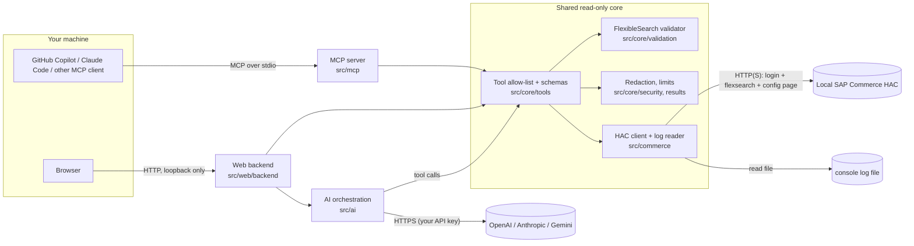

# SAP Commerce MCP & Local Workbench

Read-only inspection of a **local SAP Commerce development instance** through HAC, exposed two ways from one shared tool core:

1. **MCP server** – a local stdio process for GitHub Copilot (VS Code), Claude Code and other MCP clients.
2. **Local web workbench** – a UI plus a local backend with an AI assistant (OpenAI, Anthropic Claude or Google Gemini) that calls the very same tools.

> **Local development only. Strictly read-only.**
> This tool is for an individual developer's own machine and an authorized *development* SAP Commerce instance. It is **not** intended for production administration, shared deployment or any higher environment. It cannot create, update, delete, import, trigger or otherwise modify anything in SAP Commerce, and this is enforced in code, not by prompting (see [docs/SECURITY.md](docs/SECURITY.md)).

## Architecture



The MCP server and the web application are **two independent entry points** (`src/mcp/main.ts`, `src/web/backend/main.ts`) onto **one** tool implementation. Neither needs the other to be running, and neither can do more than the other.

## Which mode should I use?

| You want… | Use |
| --- | --- |
| Ask Copilot / Claude Code about your local Commerce instance from your editor | **MCP mode** – no AI provider key needed here; your client brings its own model |
| A visual workbench (query editor, tables, type/config/log/CronJob explorers) | **Web mode** |
| Natural-language investigation with a model you choose, in a browser | **Web mode** + at least one provider API key |

## Tools (capability inventory)

All tools are read-only and form the complete allow-list ([`src/core/tools/allowlist.ts`](src/core/tools/allowlist.ts)).

| Tool | What it does | Backend |
| --- | --- | --- |
| `flexible_search` | Run a validated read-only FlexibleSearch `SELECT` (max 200 rows) or translate it to SQL (`translate=true`) | HAC `console/flexsearch/execute` / `translate` |
| `type_info` | Super type, abstract flag, declared (optionally inherited) attributes, all sub types of a type | read-only FlexibleSearch on the type system |
| `config_get` | One configuration property, or those whose key contains a filter; secret-like values masked | HAC `platform/config` page (GET) |
| `logs_tail` | Last 1–2000 lines of the configured console log, plain-text filter, best-effort redaction | local file, read-only |
| `cronjob` | `list` CronJobs or read one `status`; cannot trigger/abort/modify | read-only FlexibleSearch |

**Deliberately not available** (the reference project implements them through HAC's Groovy scripting console, which this project never uses): `beans_info` (Spring beans) and `monitoring_info` (memory/threads/thread dump/cache/cluster). The UI therefore has no Spring-bean or diagnostics screens. Details and rationale: [docs/REFERENCE-AUDIT.md](docs/REFERENCE-AUDIT.md).

## Supported clients

| Client | Status |
| --- | --- |
| Any MCP client over stdio | Server verified with the official MCP SDK client (in-process and as a spawned child process) in the automated tests |
| GitHub Copilot in **VS Code** (agent mode) | Setup documented from vendor documentation; **not launched against the real client by the authors** |
| Claude Code | Setup documented from vendor documentation; **not launched against the real client by the authors** |
| Claude Desktop | **Untested** (same `mcpServers` shape; see [docs/MCP-SETUP.md](docs/MCP-SETUP.md)) |

No claim is made for other GitHub Copilot surfaces (JetBrains, Visual Studio, github.com, Copilot cloud agent) – see the MCP guide.

## Prerequisites

* Node.js **22.19 or newer** and npm
* A running **local** SAP Commerce instance with HAC reachable, and a HAC account allowed to use the FlexibleSearch console
* For the AI assistant only: an API key for OpenAI, Anthropic or Google Gemini (API use is billed by the provider and is separate from chat/IDE subscriptions)

## Install and build

```bash
git clone https://github.com/ritangkar/sap-commerce-mcp.git
cd sap-commerce-mcp
npm ci
npm run build          # server (dist/) + web UI (dist/web/static)
cp .env.example .env   # then edit .env: HAC_USER, HAC_PASS, ...
```

## Quick start – MCP mode

```bash
# smoke test: the process should print "read-only MCP server ready" on stderr and then wait on stdin
node dist/mcp/main.js    # Ctrl+C to stop
```

Then register `node /absolute/path/to/sap-commerce-mcp/dist/mcp/main.js` with your client. Exact, copy-pasteable configuration for VS Code/Copilot and Claude Code: **[docs/MCP-SETUP.md](docs/MCP-SETUP.md)**.

## Quick start – web mode

```bash
# add at least one provider key to .env if you want the AI assistant, e.g. ANTHROPIC_API_KEY=...
npm run start:web      # then open http://localhost:3737
```

Walkthrough (first query, provider test, reading results): **[docs/WEB-APP-SETUP.md](docs/WEB-APP-SETUP.md)**.

## Documentation

| Guide | Contents |
| --- | --- |
| [docs/MCP-SETUP.md](docs/MCP-SETUP.md) | Copilot (VS Code), Claude Code, other clients, verification, troubleshooting |
| [docs/WEB-APP-SETUP.md](docs/WEB-APP-SETUP.md) | Web app setup, providers, credentials, first-query walkthrough |
| [docs/SAP-COMMERCE-CONNECTION.md](docs/SAP-COMMERCE-CONNECTION.md) | HAC, networking, TLS, log file, authentication |
| [docs/SECURITY.md](docs/SECURITY.md) | Read-only enforcement, validator limits, secrets, local API protections |
| [docs/TROUBLESHOOTING.md](docs/TROUBLESHOOTING.md) | Problem → solution entries |
| [docs/REFERENCE-AUDIT.md](docs/REFERENCE-AUDIT.md) | Audit of the reference project and tool-by-tool inventory |
| [CONTRIBUTING.md](CONTRIBUTING.md) | Structure, commands, adding tools and providers |

## Configuration overview

Everything is configured through environment variables (a `.env` file in the repo root, or the MCP client's `env` block, which wins). The authoritative, commented list is [`.env.example`](.env.example). Required: `HAC_USER`, `HAC_PASS` (`HAC_URL` defaults to `https://localhost:9002/hac`). Nothing needs to be edited in source.

## Testing

```bash
npm test             # unit, security, MCP, web-backend and UI tests – no HAC and no API key needed
npm run typecheck    # backend + frontend
npm run lint
npm run build
LIVE_HAC=1 npm run test:live   # OPTIONAL, read-only checks against your own local HAC
```

The standard suite uses an in-process fake HAC and mocked provider SDKs. Those fixtures are **synthetic**: they model the HAC responses the reference implementation handles, not a recording of a real instance. What has *not* been verified here is listed in [docs/SECURITY.md#known-limitations](docs/SECURITY.md#known-limitations) and [docs/SAP-COMMERCE-CONNECTION.md](docs/SAP-COMMERCE-CONNECTION.md#verification-status).

## Security summary

* Explicit tool allow-list; every argument validated with strict schemas; unknown tools rejected.
* FlexibleSearch goes through an allow-list validator (single `SELECT`, no comments/`;`/`?params`/raw SQL, mutation words, non-allow-listed functions) **before** anything is sent to HAC. It is defence in depth, not a formal guarantee.
* No Groovy, ImpEx, SQL console, shell, generic HTTP, or write endpoints. The HAC client can only call a fixed set of paths (login, landing page, `platform/config`, `console/flexsearch/execute|translate`).
* HAC host must be loopback/private; TLS verification is on unless you opt out, and the opt-out applies to HAC only.
* Web backend binds to loopback, checks `Host`/`Origin`, requires a per-process token and JSON content type. API keys never reach the browser.
* Results and logs can contain sensitive data; the AI assistant sends tool results to the provider you choose.

Full details and limitations: [docs/SECURITY.md](docs/SECURITY.md).

## License and attribution

MIT, see [LICENSE](LICENSE). Parts of the HAC client and parsers are adapted from [hybris-mcp-lite](https://github.com/andreescocard/hybris-mcp-lite) by André Escocard (MIT); see [NOTICE.md](NOTICE.md) for the required notice and exactly what was adapted. SAP, SAP Commerce and Hybris are trademarks of SAP SE; this project is not affiliated with or endorsed by SAP.
